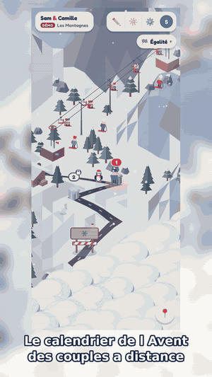
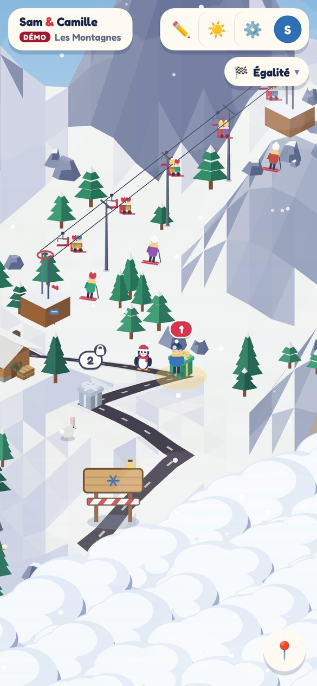
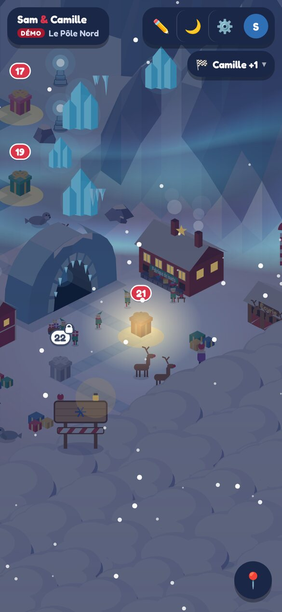
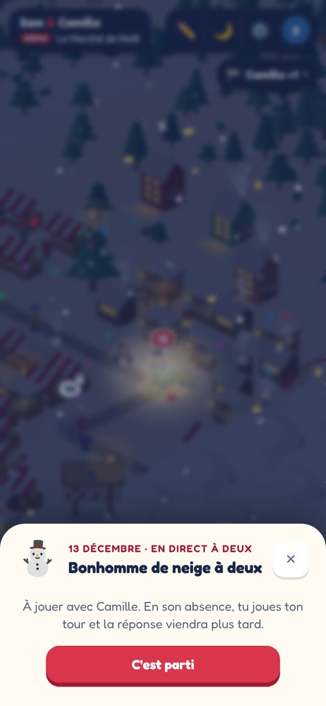

# 🎄 Chrismas Calendar

**Le calendrier de l'Avent des couples à distance, qui se joue comme un jeu mobile.**

> **In English.** Chrismas Calendar is a free, browser-based advent calendar for long-distance couples, played like a mobile game. A road runs through a continuous isometric world (mountains, Saint Nicholas village, frozen lake, Christmas market, ice cave, North Pole). 24 doors hide mini-games (some live, two players at once), and 6 doors are prepared by each partner for the other (a love note and photos). A penguin mascot, Pingou, guides you. Anyone can create their own calendar and send one link to their partner. Built with React 19, TypeScript, PixiJS 8, GSAP, Tone.js and Supabase, by one human directing a team of Claude AI agents (world, UI, games, backend, audio, QA). [Try the demo](https://elysios05.github.io/chrismas-calendar/demo/).

<p align="center">
  
  &nbsp;
  
  &nbsp;
  
</p>

<p align="center">
  <a href="https://elysios05.github.io/chrismas-calendar/demo/"><b>▶ Essayer la démo (sans compte)</b></a>
  &nbsp;·&nbsp;
  <a href="https://elysios05.github.io/chrismas-calendar/"><b>💌 Créer notre calendrier</b></a>
</p>

## Le principe

Vous êtes loin l'un de l'autre en décembre ? Ouvrez chaque jour une case ensemble, chacun de votre côté.

Une route enneigée traverse un **monde isométrique** : montagnes, village de Saint-Nicolas, lac gelé, marché de Noël, grotte de glace, pôle Nord. Chaque jour, une nouvelle case s'ouvre. Pingou, un petit pingouin, vous guide, commente et vous félicite.

**Créer votre calendrier prend quelques minutes.** Vous choisissez vos prénoms et les couleurs de vos personnages, vous recevez un lien, vous l'envoyez à votre moitié. Elle n'a rien à installer : elle ouvre le lien, choisit un mot de passe, et c'est parti. C'est gratuit pour le moment.

| Le monde de jour | Le pôle Nord de nuit | Un jeu en direct à deux |
|---|---|---|
|  |  |  |

*Captures : salon fictif « Sam & Camille ».*

## Fonctionnalités

- **24 cases** sur 6 mondes, qui s'ouvrent le jour J (rattrapage possible des jours passés).
- **Des mini-jeux variés** : quiz « Est-ce que tu me connais ? », descente en luge, pictionary, duel de friandises, rébus en emojis, attrape-flocons, bonhomme de neige à deux, pendu, mots croisés, bataille de boules de neige, sapin à décorer, tri des cadeaux…
- **Des jeux en direct à deux**, avec une version « chacun son tour » si l'autre n'est pas connecté.
- **6 cases préparées** : chacun écrit un mot doux et ajoute des photos pour l'autre.
- **Défis photo croisés** : la vue de ta fenêtre, ta déco de Noël.
- **Un salon à vous** : prénoms, couleurs des personnages, contenu personnel des jeux (questions du quiz, énigmes…).
- **Nuit selon l'heure réelle**, météo scénarisée (tempête le 10…), aurores boréales au pôle Nord.
- **Musique composée dans le navigateur** (Tone.js), coupable.
- **Rappels le soir** pour ne pas oublier sa case.
- **Téléphone et ordinateur**, rien à installer.
- Petite **course amicale** : chacun avance de son côté, un indicateur montre qui mène.

## Comment c'est fait

Le projet est un **terrain d'expérience pour le développement avec des agents IA** : une seule personne pilote, et une équipe d'agents [Claude](https://claude.com/claude-code) réalise.

| Équipe (agent) | Dossier | Rôle |
|---|---|---|
| Chef de projet | `src/core/`, `docs/` | contrats partagés, assemblage, relecture et fusion des PR |
| Monde & design | `src/world/` | monde isométrique, décors, personnages, météo |
| Interface | `src/ui/` | cases, éditeur, connexion, création de salon, Pingou |
| Jeux | `src/games/` | les mini-jeux et leur contenu |
| Backend | `src/backend/`, `supabase/` | comptes, règles d'accès, photos, temps réel |
| Audio | `src/audio/` | musique et effets générés dans le navigateur |
| Qualité | `tests/`, `docs/qa/` | tests de bout en bout, captures, performances |

Le fonctionnement : chaque équipe ne touche qu'à son dossier, travaille sur sa branche, ouvre une PR, et parle au chef de projet par issues GitHub. Les règles sont dans [`CLAUDE.md`](CLAUDE.md), les briefs dans [`docs/agents/`](docs/agents/).

| Rôle | Outil |
|---|---|
| Monde isométrique, météo, jeux d'adresse | [PixiJS](https://pixijs.com) 8 |
| Interface (cases, éditeur, connexion) | React 19 + TypeScript (strict) |
| Animations | GSAP |
| Musique générée dans le navigateur | Tone.js |
| Comptes, photos, temps réel | Supabase (avec un **mode démo sans backend**) |
| Build et hébergement | Vite, GitHub Pages via GitHub Actions |

## Lancer en local

```bash
npm install
npm run dev
```

Pour tester un jour précis : `http://localhost:5173/?jour=12`. Pour simuler la nuit : ajouter `&heure=21:00`.

Autres commandes utiles :

```bash
npm run build      # construit le site dans dist/
npm run capture -- --jour=12 --heure=21:00 --case=12 --prenoms=Sam,Camille   # capture d'écran (voir docs/qa/capture.md)
npm run qa:e2e     # tests de bout en bout
```

## Structure

```
src/
  core/       # contrats partagés (BackendApi, SoundApi, GameModule…)
  world/      # moteur du monde isométrique
    iso.ts      projection 2:1 et primitives (pavés, toits, pyramides, sapins)
    props.ts    décors vectoriels (maisons, chalets, stands, grande roue, cristaux…)
    zones.ts    les 6 mondes : couleurs jour/nuit, décors, météo
    layout.ts   génération de la route, des îlots et du placement des décors
    actors.ts   personnages et mascotte
    Scene.ts    scène Pixi : caméra liée au défilement, neige, cases
  ui/         # interface React (mascotte, cartes, salons…)
  games/      # un dossier par mini-jeu
  data/       # planning des 24 jours et contenu par défaut des jeux
  backend/    # mode démo et Supabase
  audio/      # musique et effets (Tone.js)
```

## Déploiement

Chaque push sur `main` construit le site et le publie sur GitHub Pages (`.github/workflows/deploy.yml`).
Dans le dépôt : **Settings → Pages → Source : GitHub Actions**.

---

Fait avec ❄️ pour les couples séparés par quelques centaines de kilomètres. Si le projet vous plaît, une ⭐ sur le dépôt fait très plaisir.
